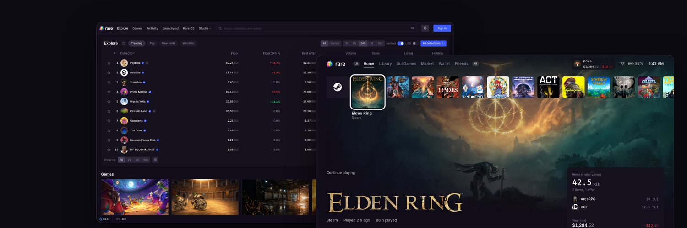
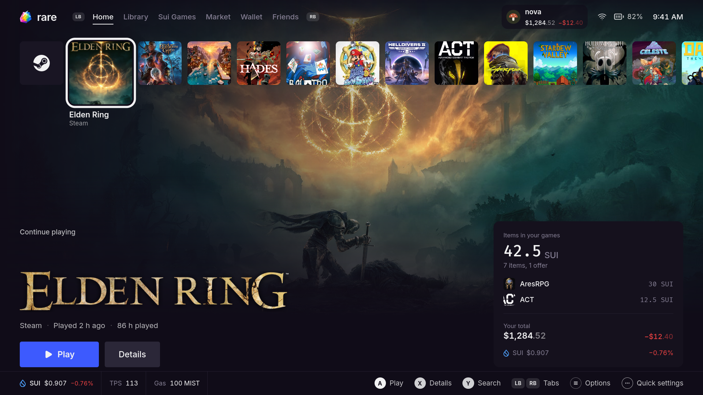
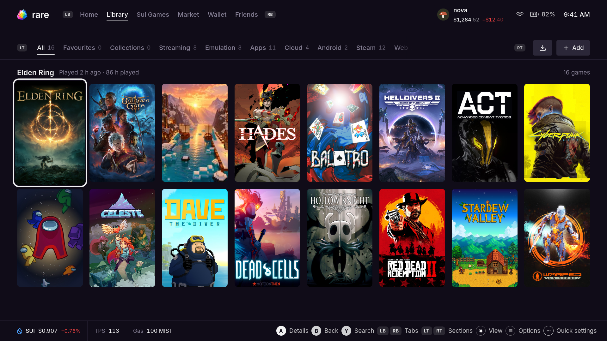
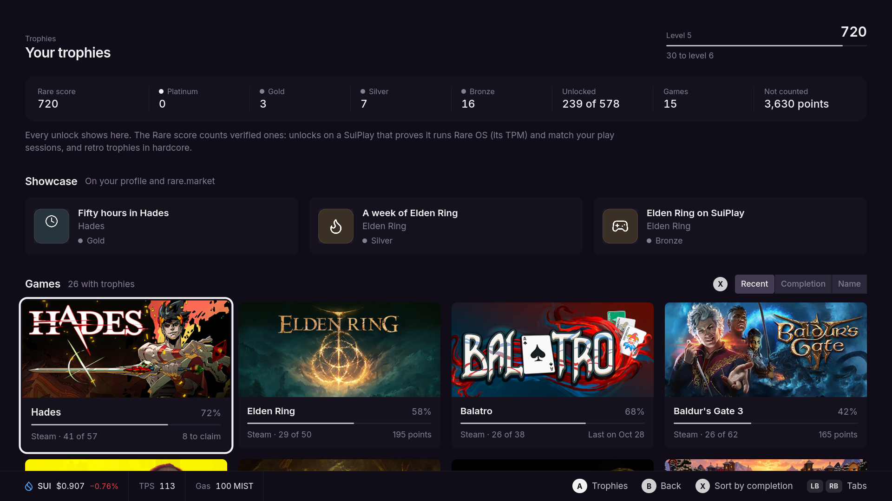
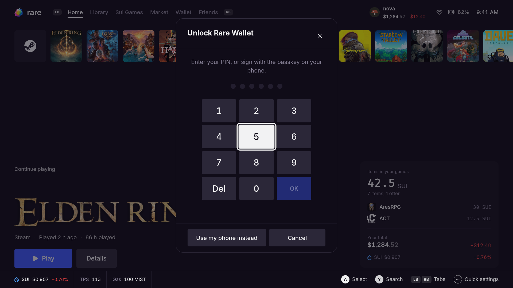

<p align="center">
  
</p>

# Rare OS

Rare OS is a handheld gaming operating system for the SuiPlay0X1. It replaces the device's stock software with a
controller-first launcher, the Rare Launcher, and a built-in self-custody wallet, the Rare Wallet. It is built on
Bazzite (Fedora Atomic) as a bootable container image, so updates are atomic and the previous system stays one step
away.

Rare OS targets the SuiPlay0X1 first. The image and the launcher also run on other x86_64 handhelds and PCs.

## Features

**Launcher**
- One library for Steam, Epic, GOG, Xbox Cloud Gaming, GeForce Now, Android apps, web games and emulators.
- One-press emulator setup, with cover art and controller profiles for each system.
- Trophies from Steam, Epic, GOG and RetroAchievements in one trophy case, plus Rare trophies for games that have
  none, verified by the device.
- Per-game performance settings (power limit, frame limit, frame generation), cloud saves and instant replay.
- PC streaming through Moonlight, Discord activity, and a phone remote.
- A Local API so games and tools on the device can read the player's items and ask for actions, each behind its
  own switch in Settings.

**Wallet and market**
- The Rare Wallet unlocks with a PIN or a passkey on a phone, and also supports a recovery phrase, Ledger and
  Keystone.
- Web games get the wallet through the Wallet Standard.
- The rare.market marketplace is one button away, including in an overlay during a game: buy, sell into bids and
  list game items without leaving the game.

**System**
- Atomic image updates, staged in the background and applied on the next restart. The previous system stays
  installed: `sudo rare-undo` or the boot menu brings it back.
- Signed images (cosign).
- SuiPlay0X1 support: panel orientation, fan control, power limits, button mapping and the device's own quirk
  files.

## Screenshots

| Home | Library |
|---|---|
|  |  |

| Trophies | Wallet |
|---|---|
|  |  |

## Install

### The launcher

Each [release](https://github.com/rare-market/rare-os/releases/latest) has
`rare-native-<version>-x86_64.tar.gz`, the native launcher with everything it needs. On a device running Rare OS:

```sh
sha256sum -c rare-native-<version>-x86_64.tar.gz.sha256
tar -xzf rare-native-<version>-x86_64.tar.gz -C ~
~/rare-native/start.sh
```

`~/rare-native/stop.sh` switches back to the launcher built into the image until the next reboot.

### The operating system

Rare OS installs next to the current system and can be undone. [docs/INSTALL.md](docs/INSTALL.md) covers the three
ways in: switching in place on GameOS, Bazzite or Fedora Atomic, a USB installer, and building the image yourself.
Published images are at `ghcr.io/rare-market/rare-os`.

## Build from source

The launcher needs Linux x86_64 with a stable Rust toolchain, a C toolchain and the development packages for
udev, D-Bus, xkbcommon, Wayland and OpenSSL.

```sh
# Launcher and its tests
cargo build --release --manifest-path launcher/native/Cargo.toml --bin rare-launcher-native
cargo test --manifest-path launcher/crates/Cargo.toml

# The release package (dist/rare-native-<version>-x86_64.tar.gz)
tools/release/build-native.sh

# The OS image (needs podman)
podman build -f image/Containerfile -t localhost/rare-os:dev .
```

`image/vm/test.sh` boots a built image in a virtual machine.

## Project layout

| Path | What it holds |
|---|---|
| `launcher/native` | The Rare Launcher (Rust): screens, input, rendering, the web game host |
| `launcher/crates` | Shared Rust crates: library, stores, emulators, wallet, market, trophies, streaming, Local API |
| `launcher/render` | Rare Render, the launcher's UI engine |
| `launcher/src`, `launcher/src-tauri` | The earlier web-based launcher, kept as a fallback |
| `image` | The OS image: Containerfile, build scripts, system files, services, VM tests |
| `third_party` | Files used from other open-source projects, with their licences |
| `tools` | Release, benchmark, emulator, journey and hardware tools |
| `docs` | Install guide, controls, streaming, emulation, wallet, Local API and other user guides |

## Contributing

Issues and pull requests are welcome. Read [CONTRIBUTING.md](CONTRIBUTING.md) first: commits follow
[Conventional Commits](https://www.conventionalcommits.org/). Report security problems privately as described in
[SECURITY.md](SECURITY.md).

## Licence

Rare OS is licensed under the [Apache License 2.0](LICENSE). Copyright 2026 Rare contributors. Third-party
components keep their own licences; see `third_party/` and `image/system_files/usr/share/rare/licenses/`.
